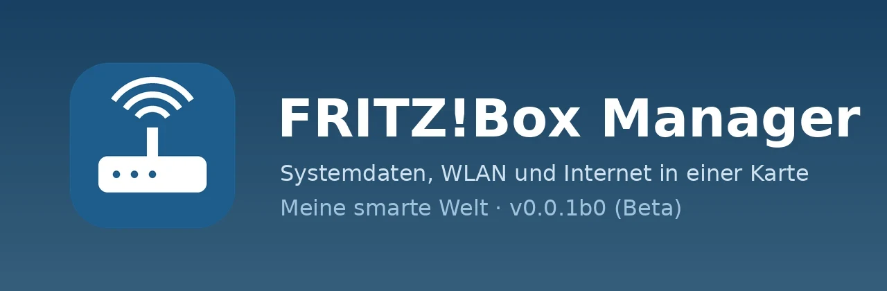
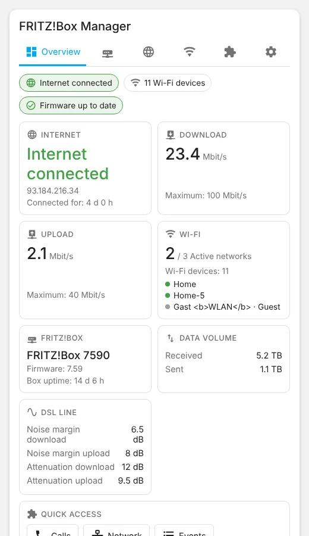
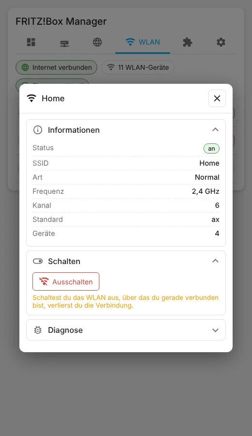

| [🇩🇪<br>**Deutsch**](README.md) | 🇬🇧<br>**English** | [🇳🇱<br>**Nederlands**](README.nl.md) |
|:-:|:-:|:-:|



# FRITZ!Box Manager

📖 Blog post: [https://meinesmartewelt.de](https://meinesmartewelt.de)

> *Short English version – the complete documentation is the [German README](README.md).*

> **Test status:** Checked against a simulated TR-064 interface and with test data in the browser. Values, units and services of other FRITZ!Box models and FRITZ!OS versions may differ (see "Known limitations").

Home Assistant integration with a dashboard card for your FRITZ!Box system data, meant as a replacement for the FRITZ!Box Tools cards. It shows overview, box, internet and Wi-Fi, opens your sibling integrations **FRITZ!Box Anrufe** (calls), **FRITZ!Box Netzwerk** (network) and **FRITZ!Box Ereignisse** (events) as popups, and has a settings tab with version display.

## Features

- Overview (cards for Internet, Download, Upload, Wi-Fi, Box, data volume, DSL and quick access – **each card can be switched on or off individually**, e.g. DSL on fibre), Box (model, firmware, uptime, optional experimental CPU temperature), Internet (status, IPs, rates, traffic, DSL values), Wi-Fi (all networks, popup, switch on/off – admins only, two-click confirm for switching off), Modules (popups of the sibling cards), Settings (version + update hint, options, maintenance, event log).
- **Backup (experimental, off by default):** trigger a backup of the FRITZ!Box settings and store it in the Home Assistant config folder – see [EXPERIMENTELL.md](EXPERIMENTELL.md) (German).
- Entities: sensors, binary sensors, Wi-Fi switches, buttons (reboot, reconnect).
- Languages: German, English, Dutch.

## What's new in 0.5.0

First public release.

- **Cards individually switchable.** Every overview card has its own switch (`show_tile_*`). Without DSL (e.g. fibre) switch off *DSL line*; the DSL values then disappear from the *Internet* category too.
- **Card editor as accordion.** Categories are collapsible sections in the editor; cards and modules sit in their category.
- **Options grouped.** Optional settings (CPU temperature, experimental features, backup, backups to keep) are in a collapsible section in the options dialog and in the card (*Settings → Options*).
- **Wi-Fi in HTTP mode** more tolerant: only the basic network data is mandatory; if the unencrypted query is refused, the encrypted interface (port 49443) is used once, also for switching. **Unverified on a real box**, cause unconfirmed. If it does not help, please report the reason shown under *Settings → Connection*.
- **CPU temperature** (experimental, off) is read from the box's web interface like *FRITZ!Box Netzwerk*. **Backup** of box settings (experimental, off): see [EXPERIMENTELL.md](EXPERIMENTELL.md) (German).
- Fibre models without DSL show "–" instead of zeros, and an empty Wi-Fi list names the reason.

## Screenshots

All images show **test data** (no real FRITZ!Box). The *Experimental* section and the card editor are not shown.

| Overview | Wi-Fi popup |
|:-:|:-:|
|  |  |

*(The Wi-Fi popup screenshot is the German one.)*

## Requirements

Home Assistant 2025.6+, a FRITZ!Box with TR-064 enabled and a user with the needed rights. The popups need the sibling integrations (optional).

## Installation

**HACS:** add `https://github.com/Meine-smarte-Welt/fritzbox_manager` as custom repository (category *Integration*). Restart Home Assistant.
**Manual:** copy `custom_components/fritzbox_manager` to `config/custom_components/`.

The card is registered as a Lovelace resource automatically (YAML mode: add `/fritzbox_manager_files/fritzbox-manager-card.js` as *module* yourself). Reload the browser (Ctrl+F5).

## Setup and card

*Settings → Devices & services → Add integration → FRITZ!Box Manager.* Card:

```yaml
type: custom:fritzbox-manager-card
```

Keys: `title`, `show_title`, `show_overview|system|internet|wifi|modules|settings`, `show_tile_internet|download|upload|wifi|box|traffic|dsl|quick`, `default_tab`, `zoom`, `read_only`, `entry_id`, `module_*_config`, `color_*`. See [`examples/`](examples/). Unlike the other managers this card has no column lists, so there is no search, filter, sort or column switches.

### Switching cards on and off

The overview consists of cards. Each one can be switched off individually, in the visual editor under **Overview** or in YAML:

```yaml
type: custom:fritzbox-manager-card
show_tile_dsl: false      # no DSL values (overview and "Internet" category), e.g. on fibre
show_tile_quick: false    # no quick access
```

Keys: `show_tile_internet`, `show_tile_download`, `show_tile_upload`, `show_tile_wifi`, `show_tile_box`, `show_tile_traffic`, `show_tile_dsl`, `show_tile_quick` (default `true`). `show_tile_dsl` also hides the DSL values in the *Internet* category. If all cards are off, the overview shows a hint.

### Card editor

In the visual editor the categories are grouped as **collapsible sections (accordion)**: *Overview* (with its cards), *Box*, *Internet*, *Wi-Fi*, *Modules* (with the modules) and *Settings*, followed by *Darstellung* (appearance), *Bearbeiten* (editing), *Experimentell* and *Farben* (colors). The editor labels are German.

## Services and events

Services (admin only): `fritzbox_manager.set_wlan`, `reconnect`, `reboot`, `check_for_update`, `create_backup` (experimental). Events: `fritzbox_manager_internet_offline`, `_internet_online`, `_ip_changed`, `_update_available`, `_backup_created`.

## Version display

The version is shown in the card settings, in the card editor and in the options dialog. GitHub is checked every 12 hours.

## Security

Write actions are admin-only and validated in the backend; risky actions need two clicks; all card text is escaped; colours are allow-listed; `read_only` hides all controls.

## Known limitations

- **Limited real-world testing.** Automated tests use a simulated TR-064 interface and browser test data. Values, units and services of other FRITZ!Box models and FRITZ!OS versions are unverified; please report differences as an issue.
- Guest Wi-Fi and frequency band are heuristics (with 3+ networks the last one counts as guest; band derived from channel; 6 GHz not distinguished).
- No CPU/RAM load; CPU temperature only experimentally via the box's undocumented web interface (off by default). The user needs web interface access; reasons are shown in the card under *Settings → Connection* (`cpu: web_login` = login rejected, `web_blocked` = login blocked, `web_unreachable` = web interface not reachable, `web_http`/`web_no_data` = unexpected reply).
- **Backup is unverified:** whether the box delivers the backup via TR-064 depends on model, FRITZ!OS, user rights and possibly two-factor confirmation; it may end with an error message. The password is not stored – without it the file cannot be restored on the box. The file format is not validated. Restoring is deliberately done on the box only (*System → Backup*).
- Fibre models have no DSL values (e.g. FRITZ!Box 5690 Pro).
- English and Dutch are not reviewed by native speakers.
- Popups need the sibling integrations and cards; Notification Center is not connected.

## Version history

| Version | Changes |
|---|---|
| **0.5.0** | First public release: integration, card with 6 categories, overview cards individually switchable, card editor with accordion, module popups, Wi-Fi switching, version display, options in a collapsible section. Experimental (off): backup, CPU temperature. |

## File integrity

`.py`, `.js` and `.yaml` files carry their SHA256 (content from line 2) in the first line. JSON files:

| File | SHA256 |
|---|---|
| `custom_components/fritzbox_manager/manifest.json` | `5236c419705c4d9b77cb1eb2ab6a97d3c208398096ada0de58968dc3e0b97fa6` |
| `custom_components/fritzbox_manager/strings.json` | `cef404d0990ac21bba2f8d3282670023b71abaac4112b43274328f174b99ddea` |
| `custom_components/fritzbox_manager/icons.json` | `b8b33129c6a6251f46d807f220e325b85d5923ec945e91a33b77a1f2f529ce0e` |
| `custom_components/fritzbox_manager/translations/de.json` | `cef404d0990ac21bba2f8d3282670023b71abaac4112b43274328f174b99ddea` |
| `custom_components/fritzbox_manager/translations/en.json` | `8e18df6cdf762fbb005e273e9a6db894624e6269b2b94443d29dbab73e699915` |
| `custom_components/fritzbox_manager/translations/nl.json` | `7665e6a3f05d5fdf3a06ef452c557d49a6a23ce4a6494280b310574fbeb7d8f3` |
| `hacs.json` | `360a813ce8c9ed6a42abd57d21c4b416646ffe3fe6777d8fd89145e9ef989a71` |

## License

MIT, see [LICENSE](LICENSE).
