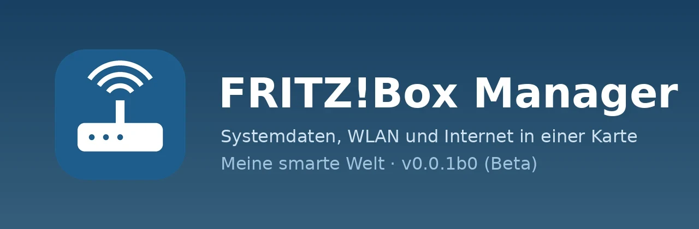
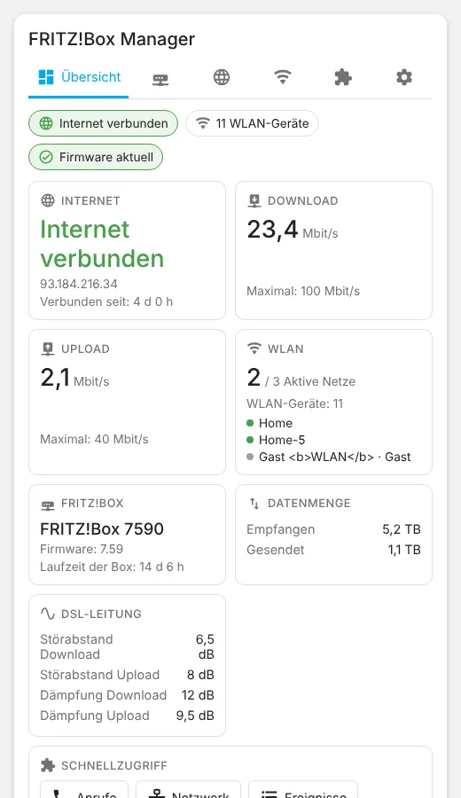
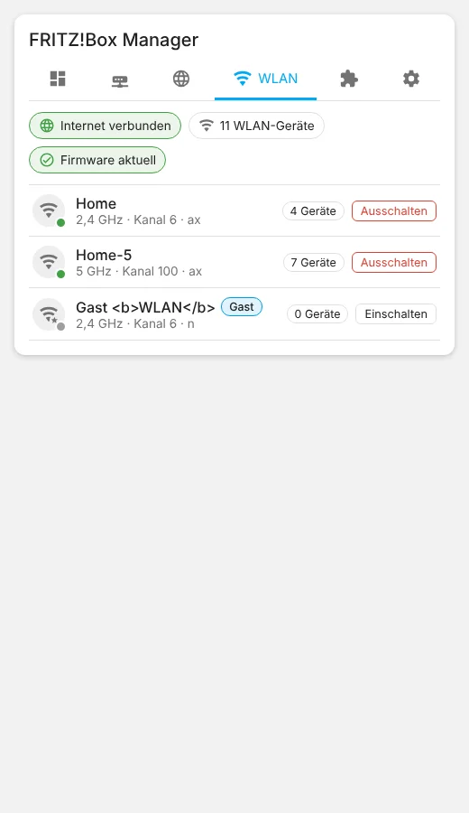
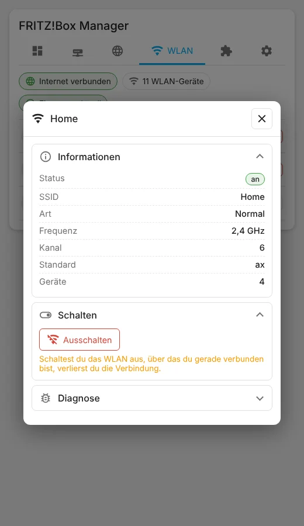
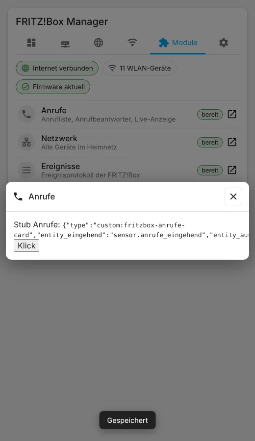
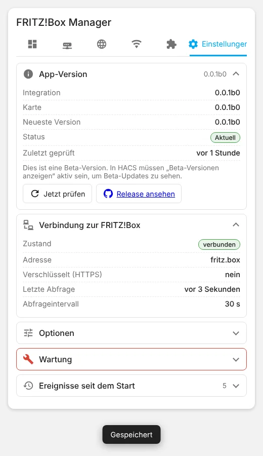

| 🇩🇪<br>**Deutsch** | [🇬🇧<br>**English**](README.en.md) | [🇳🇱<br>**Nederlands**](README.nl.md) |
|:-:|:-:|:-:|



# FRITZ!Box Manager

📖 Blogbeitrag: [https://meinesmartewelt.de](https://meinesmartewelt.de)

> **Teststand:** Geprüft gegen eine simulierte TR-064-Schnittstelle und mit Testdaten im Browser. Werte, Einheiten und Dienste anderer FRITZ!Box-Modelle und FRITZ!OS-Versionen können abweichen (siehe „Bekannte Einschränkungen“).

Home-Assistant-Integration mit Dashboard-Karte für die Systemdaten deiner FRITZ!Box – als Ersatz für die Karten rund um FRITZ!Box Tools. Die Karte zeigt Übersicht, Box, Internet und WLAN, öffnet deine Schwester-Integrationen **FRITZ!Box Anrufe**, **FRITZ!Box Netzwerk** und **FRITZ!Box Ereignisse** als Popup und hat einen Einstellungs-Tab mit Versionsanzeige.
<p>
  <a href="https://my.home-assistant.io/redirect/hacs_repository/?owner=Meine-smarte-Welt&amp;repository=fritzbox_manager&amp;category=integration"></a>
</p>
## Funktionsumfang

- **Übersicht:** Karteikarten für Internet-Status, Download, Upload, WLAN, Box, Datenmenge, DSL-Werte und Schnellzugriff auf die Module – **jede Karteikarte lässt sich einzeln ein- und ausschalten** (z. B. DSL bei Glasfaser).
- **Box:** Modell, Firmware (inkl. Hinweis auf verfügbares Update), Hardware, Laufzeit, bekannte Netzwerkgeräte, optional CPU-Temperatur (experimentell).
- **Internet:** Verbindungsstatus, Laufzeit, externe IPv4/IPv6, IPv6-Präfix, Leitungsraten, Datenmenge, letzter Fehler, DSL-Werte.
- **WLAN:** alle Funknetze mit Kanal, Standard, Geräten; Popup mit Details; Netze ein-/ausschalten (nur Administratoren, Ausschalten mit Zwei-Klick-Bestätigung).
- **Module:** Popups, die die Karten deiner Integrationen *FRITZ!Box Anrufe*, *Netzwerk* und *Ereignisse* einbetten. Entitäten werden automatisch erkannt; von Hand festlegbar.
- **Einstellungen:** App-Version mit Update-Hinweis, Verbindung, Optionen (Intervall, Ereignisse; optionale Einstellungen wie die CPU-Temperatur in einem einklappbaren Unterabschnitt), Wartung (Neu verbinden, Neustart – Zwei-Klick), Ereignisprotokoll.
- **Backup (experimentell, standardmäßig aus):** Sicherung der FRITZ!Box-Einstellungen anstoßen und im Home-Assistant-Konfigurationsordner speichern – siehe [EXPERIMENTELL.md](EXPERIMENTELL.md).
- Entitäten: Sensoren, Binärsensoren, WLAN-Schalter, Schaltflächen (Neustart, Neu verbinden).
- Sprachen: Deutsch, Englisch, Niederländisch.

## Neu in 0.5.0

Erste öffentliche Version.

- **Karteikarten einzeln ein-/ausschaltbar.** Jede Karteikarte der Übersicht hat einen eigenen Schalter (`show_tile_*`). Wer kein DSL hat (z. B. Glasfaser), schaltet *DSL-Leitung* aus; die DSL-Werte verschwinden dann auch in der Kategorie *Internet*.
- **Karten-Editor als Akkordeon.** Die Kategorien stehen als einklappbare Abschnitte im Editor; Karteikarten und Module liegen jeweils in ihrer Kategorie.
- **Optionen gebündelt.** Optionale Einstellungen (CPU-Temperatur, Experimentelle Funktionen, Backup, Anzahl Backups) stehen im Optionen-Dialog und in der Karte (*Einstellungen → Optionen*) in einem einklappbaren Abschnitt.
- **WLAN im HTTP-Modus** toleranter: nur die Netz-Grundangaben sind Pflicht, bei verweigerter unverschlüsselter Abfrage wird einmal die verschlüsselte Schnittstelle (Port 49443) genutzt; das gilt auch fürs Schalten. **Ungeprüft an einer echten Box**, Ursache nicht bestätigt. Hilft das nicht, nenne bitte den Grund, den die Karte unter *Einstellungen → Verbindung* zeigt.
- **CPU-Temperatur** (experimentell, aus) wird wie bei *FRITZ!Box Netzwerk* über die Weboberfläche der Box gelesen. **Backup** der Box-Einstellungen (experimentell, aus): siehe [EXPERIMENTELL.md](EXPERIMENTELL.md).
- Glasfaser-Modelle ohne DSL zeigen „–“ statt Nullwerten, und bei leerer WLAN-Liste nennt die Karte den Grund.

## Bilder

Alle Bilder zeigen **Testdaten** (keine echte FRITZ!Box). Der Bereich *Experimentell* und der Karten-Editor sind darauf nicht zu sehen.

| Übersicht | WLAN | WLAN-Popup |
|:-:|:-:|:-:|
|  |  |  |

| Modul-Popup | Einstellungen |
|:-:|:-:|
|  |  |

Im Modul-Popup siehst du hier eine Platzhalterkarte; im Betrieb erscheint dort die Karte deiner Schwester-Integration.

## Voraussetzungen

- Home Assistant 2025.6 oder neuer.
- FRITZ!Box mit aktivierter TR-064-Schnittstelle („Zugriff für Anwendungen zulassen“ unter Heimnetz → Netzwerk → Netzwerkeinstellungen) und einem Benutzer mit den Rechten **FRITZ!Box Einstellungen** (und für Neustart/WLAN-Schalten entsprechende Rechte).
- Für die Popups: die Integrationen [FRITZ!Box Anrufe](https://github.com/Meine-smarte-Welt/fritzbox_anrufe), [FRITZ!Box Netzwerk](https://github.com/Meine-smarte-Welt/fritzbox_netzwerk) und [FRITZ!Box Ereignisse](https://github.com/Meine-smarte-Welt/fritzbox_ereignisse) (jeweils optional).

## Installation

**HACS:** Benutzerdefiniertes Repository `https://github.com/Meine-smarte-Welt/fritzbox_manager` (Kategorie *Integration*) hinzufügen. Herunterladen, Home Assistant neu starten.

**Manuell:** Ordner `custom_components/fritzbox_manager` nach `config/custom_components/` kopieren, neu starten.

Die Karte wird automatisch als Lovelace-Ressource (`/fritzbox_manager_files/fritzbox-manager-card.js`) eingetragen. Im YAML-Modus trägst du sie selbst ein (Typ *module*). Danach Browser neu laden (Strg+F5).

## Einrichtung

*Einstellungen → Geräte & Dienste → Integration hinzufügen → FRITZ!Box Manager.* Host (meist `fritz.box`), Benutzername, Passwort, optional HTTPS. Über „Neu konfigurieren“ änderst du die Zugangsdaten, über „Konfigurieren“ die Optionen.

## Die Karte

```yaml
type: custom:fritzbox-manager-card
```

Wichtige Schlüssel: `title`, `show_title`, `show_overview|system|internet|wifi|modules|settings`, `show_tile_internet|download|upload|wifi|box|traffic|dsl|quick`, `show_experimental`, `default_tab`, `zoom`, `read_only`, `entry_id` (nur bei mehreren Boxen), `module_calls_config`, `module_network_config`, `module_events_config`, `color_*`. Alles ist auch im grafischen Editor einstellbar. Beispiele: [`examples/`](examples/).

### Karteikarten ein- und ausschalten

Die Übersicht besteht aus Karteikarten. Jede lässt sich einzeln ausschalten, im grafischen Editor unter **Übersicht** oder per YAML:

```yaml
type: custom:fritzbox-manager-card
show_tile_dsl: false      # keine DSL-Werte (Übersicht und Kategorie „Internet“), z. B. bei Glasfaser
show_tile_quick: false    # kein Schnellzugriff
```

Schlüssel: `show_tile_internet`, `show_tile_download`, `show_tile_upload`, `show_tile_wifi`, `show_tile_box`, `show_tile_traffic`, `show_tile_dsl`, `show_tile_quick` (Standard jeweils `true`). `show_tile_dsl` blendet die DSL-Werte auch in der Kategorie *Internet* aus. Sind alle Karteikarten aus, zeigt die Übersicht einen Hinweis.

### Karten-Editor

Im grafischen Editor sind die Kategorien als **einklappbare Abschnitte (Akkordeon)** zusammengefasst: *Übersicht* (mit den Karteikarten), *Box*, *Internet*, *WLAN*, *Module* (mit den Modulen) und *Einstellungen*, danach *Darstellung*, *Bearbeiten*, *Experimentell* und *Farben*.

> Abweichung von den anderen Managern: Diese Karte hat keine Spaltenlisten und deshalb **keine** Suche, Filter, Sortierung oder Spaltenschalter.

## Farben

Leer = Theme-Standard. Erlaubt sind Hex, `rgb()`, `hsl()`, `var(--…)`; Ungültiges wird verworfen.

| Schlüssel | Bedeutung |
|---|---|
| `color_tab_active` | aktiver Tab |
| `color_success` / `color_warning` / `color_error` / `color_info` | Statusfarben |
| `color_row_icon` | Zeilensymbole |
| `color_live_banner` | Banner |
| `color_icon_<tab>` | Symbolfarbe je Kategorie |

## Services

| Service | Wirkung |
|---|---|
| `fritzbox_manager.set_wlan` | WLAN-Netz (`wlan1`…`wlan9`) ein-/ausschalten |
| `fritzbox_manager.reconnect` | Internetverbindung neu aufbauen |
| `fritzbox_manager.reboot` | Box neu starten |
| `fritzbox_manager.check_for_update` | App-Version bei GitHub prüfen |
| `fritzbox_manager.create_backup` | *Experimentell:* Backup der Box-Einstellungen erstellen (`password` erforderlich; nur mit aktivierten Schaltern) |

Alle Services sind Administratoren vorbehalten; `entry_id` ist optional.

## Ereignisse

`fritzbox_manager_internet_offline`, `fritzbox_manager_internet_online`, `fritzbox_manager_ip_changed` (mit `ip`, `previous_ip`), `fritzbox_manager_update_available` (mit `version`), `fritzbox_manager_backup_created` (mit `filename`, `size`; nur mit aktiviertem Backup). Alle tragen `entry_id`. Abschaltbar; beim Start wird nur der Ausgangszustand gemerkt (keine Ereignisflut). Beispiele: [`examples/`](examples/).

## Sensoren

Firmware, Laufzeit der Box und der Verbindung, externe IPv4/IPv6, IPv6-Präfix, Download-/Upload-Rate, maximale Leitungsraten, empfangene/gesendete Daten, letzter Verbindungsfehler, WLAN-Geräte, bekannte Netzwerkgeräte, DSL-Störabstand und -Dämpfung (nur wenn die Box Werte liefert), CPU-Temperatur (nur mit aktivierter Option). Binärsensoren: Internet, Leitung, Firmware-Update. Schalter: je WLAN-Netz. Schaltflächen: Neustart, Neu verbinden.

## Versionsanzeige und Update-Hinweis

Die Version steht an drei Stellen: Karte → Zahnrad → *App-Version*, oben im Karten-Editor und im Optionen-Dialog. Alle 12 Stunden wird GitHub nach einer neueren Version gefragt. Ist GitHub nicht erreichbar, läuft alles normal weiter.

## Einstellungen

Abfrageintervall (10–600 s, Standard 30 s) und Ereignisse senden. Alle weiteren Einstellungen stehen im Optionen-Dialog (*Konfigurieren*) in einem einklappbaren Abschnitt **Optionale Einstellungen**: CPU-Temperatur (experimentell, aus), Experimentelle Funktionen (Hauptschalter, aus), Backup (experimentell, aus), Anzahl aufbewahrter Backups (1–50, Standard 10). In der Karte stehen sie unter *Einstellungen → Optionen → Optionale Einstellungen*. Der Bereich *Experimentell* erscheint in der Karte nur mit `show_experimental: true`.

## Sicherheit

- Schreibende Aktionen (WLAN schalten, Neustart, Neu verbinden, Backup, Optionen) nur für Administratoren, im Backend geprüft.
- Riskante Aktionen mit Zwei-Klick-Bestätigung.
- Alle Texte in der Karte werden maskiert, Farbwerte nur über eine Allowlist übernommen.
- Host und HTTPS-Angabe werden nur Administratoren übermittelt; die Diagnose anonymisiert Zugangsdaten und Adressen.
- `read_only` blendet alle Bedienelemente aus.

## Bekannte Einschränkungen

- **Begrenzter Praxistest.** Die automatischen Tests laufen gegen eine simulierte TR-064-Schnittstelle (Backend) und mit Testdaten im Browser (Karte). Dienste, Werte und Einheiten anderer FRITZ!Box-Modelle und FRITZ!OS-Versionen sind **ungeprüft**; je nach Modell können Werte fehlen. Abweichungen bitte als Issue melden.
- **Gast-WLAN und Frequenzband sind Heuristiken:** Nutzt die Box keine passenden Angaben, gilt bei mindestens drei Netzen das letzte als Gast-Netz, das Band wird aus dem Kanal abgeleitet (6 GHz wird nicht unterschieden).
- **Keine CPU-/RAM-Auslastung.** Nur die CPU-Temperatur, experimentell, über die nicht öffentlich dokumentierte Weboberfläche der Box (standardmäßig aus). Der Benutzer braucht Zugriff auf die Weboberfläche; Fehlergründe stehen in der Karte unter *Einstellungen → Verbindung* (`cpu: web_login` = Anmeldung abgelehnt, `web_blocked` = Anmeldung gesperrt, `web_unreachable` = Weboberfläche nicht erreichbar, `web_http`/`web_no_data` = unerwartete Antwort).
- **Nur teilweise übersetzt geprüft:** Englisch und Niederländisch sind nicht von Muttersprachlern geprüft.
- Die Popups brauchen die jeweilige Schwester-Integration samt Karte; ohne sie zeigt die Karte eine Anleitung statt der Funktion.
- **Backup ist ungeprüft:** Ob die Box die Sicherung über TR-064 ausliefert, hängt von Modell, FRITZ!OS, Benutzerrechten und ggf. Zwei-Faktor-Bestätigung ab; es kann mit einem Fehlertext enden. Das Kennwort wird nicht gespeichert – ohne es lässt sich die Datei nicht an der Box einspielen. Das Dateiformat wird nicht geprüft (nur Größe und Typ). Das Einspielen geschieht bewusst nur an der Box selbst (*System → Sicherung*).
- **Glasfaser-Modelle haben keine DSL-Werte** (z. B. FRITZ!Box 5690 Pro): Dort bleiben die DSL-Felder leer.
- Notification Center (`#nc`) ist nicht angebunden.

## Fehlerbehebung

- *Karte nicht gefunden:* Seite mit Strg+F5 neu laden; im YAML-Modus die Ressource von Hand eintragen.
- *Anmeldung schlägt fehl:* TR-064 und Benutzerrechte an der Box prüfen.
- *Popup zeigt „nicht gefunden“:* Schwester-Integration installieren oder Entitäten über `module_*_config` angeben.
- Fehler bitte mit Diagnose-Download unter [Issues](https://github.com/Meine-smarte-Welt/fritzbox_manager/issues) melden.

## Versionshistorie

| Version | Änderungen |
|---|---|
| **0.5.0** | Erste öffentliche Version: Integration, Karte mit 6 Kategorien, Karteikarten der Übersicht einzeln ein-/ausschaltbar, Karten-Editor mit Akkordeon, Module-Popups, WLAN-Schalten, Versionsanzeige, Optionen in einklappbarem Abschnitt. Experimentell (aus): Backup, CPU-Temperatur. |

## Datei-Integrität

Die `.py`-, `.js`- und `.yaml`-Dateien tragen den SHA256-Hash ab Zeile 2 in der ersten Zeile (`tail -n +2 datei | sha256sum`). Für JSON-Dateien:

| Datei | SHA256 |
|---|---|
| `custom_components/fritzbox_manager/manifest.json` | `5236c419705c4d9b77cb1eb2ab6a97d3c208398096ada0de58968dc3e0b97fa6` |
| `custom_components/fritzbox_manager/strings.json` | `cef404d0990ac21bba2f8d3282670023b71abaac4112b43274328f174b99ddea` |
| `custom_components/fritzbox_manager/icons.json` | `b8b33129c6a6251f46d807f220e325b85d5923ec945e91a33b77a1f2f529ce0e` |
| `custom_components/fritzbox_manager/translations/de.json` | `cef404d0990ac21bba2f8d3282670023b71abaac4112b43274328f174b99ddea` |
| `custom_components/fritzbox_manager/translations/en.json` | `8e18df6cdf762fbb005e273e9a6db894624e6269b2b94443d29dbab73e699915` |
| `custom_components/fritzbox_manager/translations/nl.json` | `7665e6a3f05d5fdf3a06ef452c557d49a6a23ce4a6494280b310574fbeb7d8f3` |
| `hacs.json` | `360a813ce8c9ed6a42abd57d21c4b416646ffe3fe6777d8fd89145e9ef989a71` |

## Lizenz

MIT, siehe [LICENSE](LICENSE).
