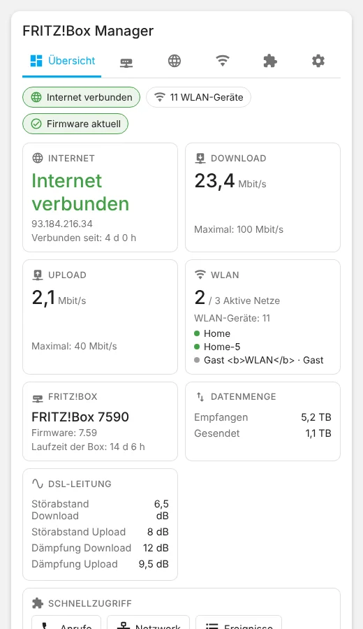
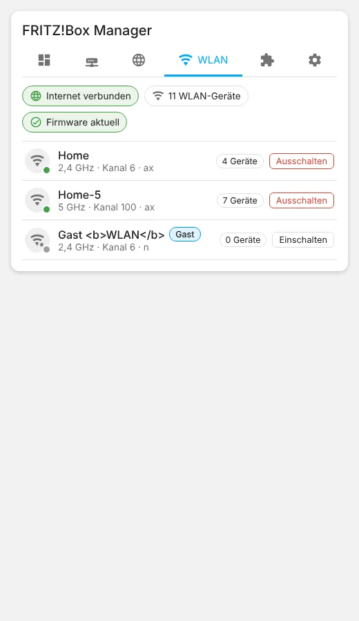
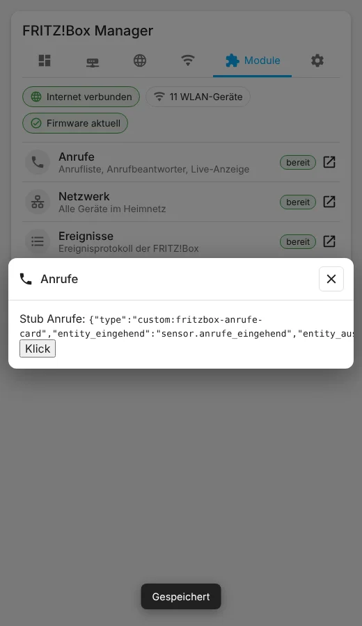
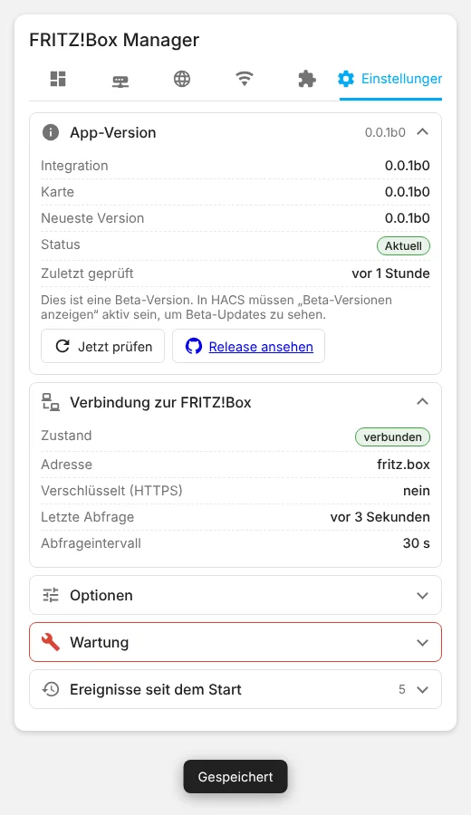

| 🇩🇪<br>**Deutsch** | [🇬🇧<br>**English**](README.en.md) | [🇳🇱<br>**Nederlands**](README.nl.md) |
|:-:|:-:|:-:|


# FRITZ!Box Manager

📖 Blogbeitrag: [https://meinesmartewelt.de](https://meinesmartewelt.de)

> **⚠️ Beta (Pre-release 0.0.1b0).** Diese Version ist **nicht an einer echten FRITZ!Box getestet**. Sie wurde gegen eine simulierte TR-064-Schnittstelle und mit Testdaten im Browser geprüft. Alles, was das Verhalten einer echten Box betrifft, ist **ungeprüft** (siehe „Bekannte Einschränkungen“).

Home-Assistant-Integration mit Dashboard-Karte für die Systemdaten deiner FRITZ!Box – als Ersatz für die Karten rund um FRITZ!Box Tools. Die Karte zeigt Übersicht, Box, Internet und WLAN, öffnet deine Schwester-Integrationen **FRITZ!Box Anrufe**, **FRITZ!Box Netzwerk** und **FRITZ!Box Ereignisse** als Popup und hat einen Einstellungs-Tab mit Versionsanzeige.

## Funktionsumfang

- **Übersicht:** Internet-Status, Download/Upload, WLAN, Box, Datenmenge, DSL-Werte, Schnellzugriff auf die Module.
- **Box:** Modell, Firmware (inkl. Hinweis auf verfügbares Update), Hardware, Laufzeit, bekannte Netzwerkgeräte, optional CPU-Temperatur (experimentell).
- **Internet:** Verbindungsstatus, Laufzeit, externe IPv4/IPv6, IPv6-Präfix, Leitungsraten, Datenmenge, letzter Fehler, DSL-Werte.
- **WLAN:** alle Funknetze mit Kanal, Standard, Geräten; Popup mit Details; Netze ein-/ausschalten (nur Administratoren, Ausschalten mit Zwei-Klick-Bestätigung).
- **Module:** Popups, die die Karten deiner Integrationen *FRITZ!Box Anrufe*, *Netzwerk* und *Ereignisse* einbetten. Entitäten werden automatisch erkannt; von Hand festlegbar.
- **Einstellungen:** App-Version mit Update-Hinweis, Verbindung, Optionen (Intervall, Ereignisse, CPU-Temperatur), Wartung (Neu verbinden, Neustart – Zwei-Klick), Ereignisprotokoll.
- Entitäten: Sensoren, Binärsensoren, WLAN-Schalter, Schaltflächen (Neustart, Neu verbinden).
- Sprachen: Deutsch, Englisch, Niederländisch.

## Neu in 0.0.1b0

Erste Veröffentlichung (Beta).

## Bilder

Alle Bilder zeigen **Version 0.0.1b0 mit Testdaten** (keine echte FRITZ!Box).

| Übersicht | WLAN | WLAN-Popup |
|:-:|:-:|:-:|
|  |  |  |

| Modul-Popup | Einstellungen |
|:-:|:-:|
|  |  |

Im Modul-Popup siehst du hier eine Platzhalterkarte; im Betrieb erscheint dort die Karte deiner Schwester-Integration.

## Voraussetzungen

- Home Assistant 2025.6 oder neuer.
- FRITZ!Box mit aktivierter TR-064-Schnittstelle („Zugriff für Anwendungen zulassen“ unter Heimnetz → Netzwerk → Netzwerkeinstellungen) und einem Benutzer mit den Rechten **FRITZ!Box Einstellungen** (und für Neustart/WLAN-Schalten entsprechende Rechte).
- Für die Popups: die Integrationen [FRITZ!Box Anrufe](https://github.com/Meine-smarte-Welt/fritzbox_anrufe), [FRITZ!Box Netzwerk](https://github.com/Meine-smarte-Welt/fritzbox_netzwerk) und [FRITZ!Box Ereignisse](https://github.com/Meine-smarte-Welt/fritzbox_ereignisse) (jeweils optional).

## Installation

**HACS:** Benutzerdefiniertes Repository `https://github.com/Meine-smarte-Welt/fritzbox_manager` (Kategorie *Integration*) hinzufügen. Da es sich um ein Pre-release handelt, muss in HACS bei diesem Repository **„Beta-Versionen anzeigen“** aktiviert sein. Herunterladen, Home Assistant neu starten.

**Manuell:** Ordner `custom_components/fritzbox_manager` nach `config/custom_components/` kopieren, neu starten.

Die Karte wird automatisch als Lovelace-Ressource (`/fritzbox_manager_files/fritzbox-manager-card.js`) eingetragen. Im YAML-Modus trägst du sie selbst ein (Typ *module*). Danach Browser neu laden (Strg+F5).

## Einrichtung

*Einstellungen → Geräte & Dienste → Integration hinzufügen → FRITZ!Box Manager.* Host (meist `fritz.box`), Benutzername, Passwort, optional HTTPS. Über „Neu konfigurieren“ änderst du die Zugangsdaten, über „Konfigurieren“ die Optionen.

## Die Karte

```yaml
type: custom:fritzbox-manager-card
```

Wichtige Schlüssel: `title`, `show_title`, `show_overview|system|internet|wifi|modules|settings`, `default_tab`, `zoom`, `read_only`, `entry_id` (nur bei mehreren Boxen), `module_calls_config`, `module_network_config`, `module_events_config`, `color_*`. Alles ist auch im grafischen Editor einstellbar. Beispiele: [`examples/`](examples/).

> Abweichung von den anderen Managern: Diese Karte hat keine Spaltenlisten und deshalb **keine** Suche, Filter, Sortierung oder Spaltenschalter.

## Farben

Leer = Theme-Standard. Erlaubt sind Hex, `rgb()`, `hsl()`, `var(--…)`; Ungültiges wird verworfen.

| Schlüssel | Bedeutung |
|---|---|
| `color_tab_active` | aktiver Tab |
| `color_success` / `color_warning` / `color_error` / `color_info` | Statusfarben |
| `color_row_icon` | Zeilensymbole |
| `color_live_banner` | Banner |
| `color_icon_<tab>` | Symbolfarbe je Kategorie |

## Services

| Service | Wirkung |
|---|---|
| `fritzbox_manager.set_wlan` | WLAN-Netz (`wlan1`…`wlan9`) ein-/ausschalten |
| `fritzbox_manager.reconnect` | Internetverbindung neu aufbauen |
| `fritzbox_manager.reboot` | Box neu starten |
| `fritzbox_manager.check_for_update` | App-Version bei GitHub prüfen |

Alle Services sind Administratoren vorbehalten; `entry_id` ist optional.

## Ereignisse

`fritzbox_manager_internet_offline`, `fritzbox_manager_internet_online`, `fritzbox_manager_ip_changed` (mit `ip`, `previous_ip`), `fritzbox_manager_update_available` (mit `version`). Alle tragen `entry_id`. Abschaltbar; beim Start wird nur der Ausgangszustand gemerkt (keine Ereignisflut). Beispiele: [`examples/`](examples/).

## Sensoren

Firmware, Laufzeit der Box und der Verbindung, externe IPv4/IPv6, IPv6-Präfix, Download-/Upload-Rate, maximale Leitungsraten, empfangene/gesendete Daten, letzter Verbindungsfehler, WLAN-Geräte, bekannte Netzwerkgeräte, DSL-Störabstand und -Dämpfung (nur wenn die Box Werte liefert), CPU-Temperatur (nur mit aktivierter Option). Binärsensoren: Internet, Leitung, Firmware-Update. Schalter: je WLAN-Netz. Schaltflächen: Neustart, Neu verbinden.

## Versionsanzeige und Update-Hinweis

Die Version steht an drei Stellen: Karte → Zahnrad → *App-Version*, oben im Karten-Editor und im Optionen-Dialog. Alle 12 Stunden wird GitHub nach einer neueren Version gefragt (auch Pre-releases, solange eine Beta läuft). Ist GitHub nicht erreichbar, läuft alles normal weiter.

## Einstellungen

Abfrageintervall (10–600 s, Standard 30 s), Ereignisse senden, CPU-Temperatur (experimentell, aus).

## Sicherheit

- Schreibende Aktionen (WLAN schalten, Neustart, Neu verbinden, Optionen) nur für Administratoren, im Backend geprüft.
- Riskante Aktionen mit Zwei-Klick-Bestätigung.
- Alle Texte in der Karte werden maskiert, Farbwerte nur über eine Allowlist übernommen.
- Host und HTTPS-Angabe werden nur Administratoren übermittelt; die Diagnose anonymisiert Zugangsdaten und Adressen.
- `read_only` blendet alle Bedienelemente aus.

## Bekannte Einschränkungen

- **Nicht an echter Hardware getestet.** Getestet wurde gegen eine simulierte TR-064-Schnittstelle (Backend) und mit Testdaten im Browser (Karte). Dienste, Werte und Einheiten einer echten FRITZ!Box sind **ungeprüft**; je nach Modell/FRITZ!OS können Werte fehlen.
- **Gast-WLAN und Frequenzband sind Heuristiken:** Nutzt die Box keine passenden Angaben, gilt bei mindestens drei Netzen das letzte als Gast-Netz, das Band wird aus dem Kanal abgeleitet (6 GHz wird nicht unterschieden).
- **Keine CPU-/RAM-Auslastung.** Nur die CPU-Temperatur, experimentell, über eine nicht öffentlich dokumentierte Schnittstelle (standardmäßig aus).
- **Nur teilweise übersetzt geprüft:** Englisch und Niederländisch sind nicht von Muttersprachlern geprüft.
- Die Popups brauchen die jeweilige Schwester-Integration samt Karte; ohne sie zeigt die Karte eine Anleitung statt der Funktion.
- Notification Center (`#nc`) ist nicht angebunden.
- Pre-release: HACS zeigt sie nur mit „Beta-Versionen anzeigen“.

## Fehlerbehebung

- *Karte nicht gefunden:* Seite mit Strg+F5 neu laden; im YAML-Modus die Ressource von Hand eintragen.
- *Anmeldung schlägt fehl:* TR-064 und Benutzerrechte an der Box prüfen.
- *Popup zeigt „nicht gefunden“:* Schwester-Integration installieren oder Entitäten über `module_*_config` angeben.
- Fehler bitte mit Diagnose-Download unter [Issues](https://github.com/Meine-smarte-Welt/fritzbox_manager/issues) melden.

## Versionshistorie

| Version | Änderungen |
|---|---|
| **0.0.1b0** | Erste Veröffentlichung (Beta): Integration, Karte mit 6 Kategorien, Module-Popups, WLAN-Schalten, Versionsanzeige. |

## Datei-Integrität

Die `.py`-, `.js`- und `.yaml`-Dateien tragen den SHA256-Hash ab Zeile 2 in der ersten Zeile (`tail -n +2 datei | sha256sum`). Für JSON-Dateien:

| Datei | SHA256 |
|---|---|
| `custom_components/fritzbox_manager/manifest.json` | `022c1b926219685a562217fcd06bd250351ba4cc1c1d7d5223e77034438b1eb2` |
| `custom_components/fritzbox_manager/strings.json` | `8b4f38becb3430565684d940f32e5c7015877cabcd73ae1443a24c8cee764299` |
| `custom_components/fritzbox_manager/icons.json` | `c8d53de9c2e752cc325931793c937d331e948851fe57ce2bbbb5acc49d0ecab4` |
| `custom_components/fritzbox_manager/translations/de.json` | `8b4f38becb3430565684d940f32e5c7015877cabcd73ae1443a24c8cee764299` |
| `custom_components/fritzbox_manager/translations/en.json` | `a27e218de9de4e967205dbbdb1d8d20b24b9f4d81d1fa44fb2ca01bccc52a4e1` |
| `custom_components/fritzbox_manager/translations/nl.json` | `45cd17e4bb7244818ad1abf62eecdf3c972ab2faaeab8f06dde53dd37a7dcaad` |
| `hacs.json` | `360a813ce8c9ed6a42abd57d21c4b416646ffe3fe6777d8fd89145e9ef989a71` |

## Lizenz

MIT, siehe [LICENSE](LICENSE).
