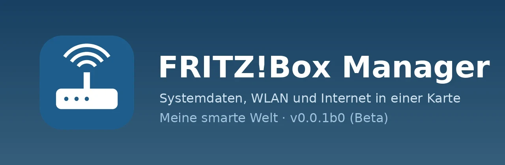
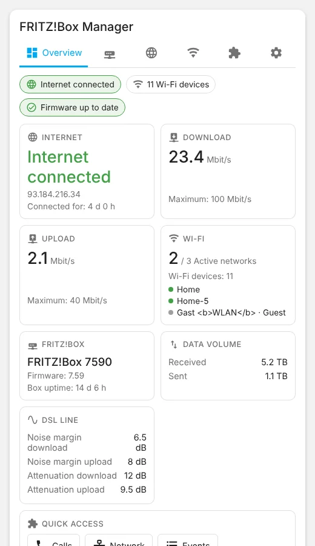
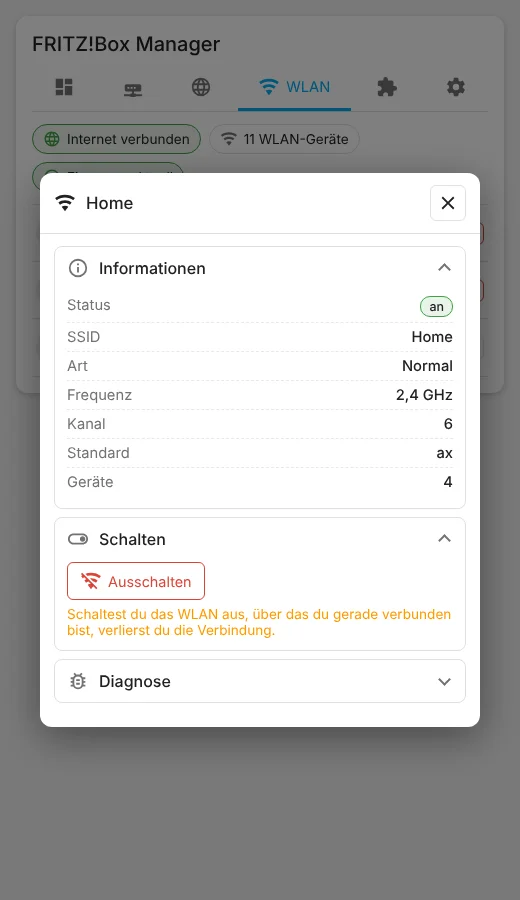

| [🇩🇪<br>**Deutsch**](README.md) | [🇬🇧<br>**English**](README.en.md) | 🇳🇱<br>**Nederlands** |
|:-:|:-:|:-:|



# FRITZ!Box Manager

📖 Blogartikel: [https://meinesmartewelt.de](https://meinesmartewelt.de)

> *Verkorte Nederlandse versie – de volledige documentatie is de [Duitse README](README.md).*

> **⚠️ Bèta (pre-release 0.0.2b1).** Deze versie is **niet getest met een echte FRITZ!Box**. Ze is gecontroleerd met een gesimuleerde TR-064-interface en met testgegevens in de browser. Alles wat van het gedrag van een echte box afhangt, is **niet gecontroleerd** (zie "Bekende beperkingen").

Home Assistant-integratie met dashboardkaart voor de systeemgegevens van je FRITZ!Box, bedoeld als vervanging van de kaarten rond FRITZ!Box Tools. De kaart toont overzicht, box, internet en wifi, opent je zusterintegraties **FRITZ!Box Anrufe** (gesprekken), **FRITZ!Box Netzwerk** (netwerk) en **FRITZ!Box Ereignisse** (gebeurtenissen) als popup en heeft een instellingentab met versieweergave.

## Functies

- Overzicht, Box (model, firmware, uptime, optioneel experimentele CPU-temperatuur), Internet (status, IP's, snelheden, dataverkeer, DSL-waarden), Wifi (alle netwerken, popup, in-/uitschakelen – alleen beheerders, uitschakelen met bevestiging in twee klikken), Modules (popups van de zusterkaarten), Instellingen (versie + updatemelding, opties, onderhoud, gebeurtenissenlogboek).
- **Back-up (experimenteel, standaard uit):** een back-up van de FRITZ!Box-instellingen starten en opslaan in de Home Assistant-configuratiemap – zie [EXPERIMENTELL.md](EXPERIMENTELL.md) (Duits).
- Entiteiten: sensoren, binaire sensoren, wifi-schakelaars, knoppen (herstart, opnieuw verbinden).
- Talen: Duits, Engels, Nederlands.

## Nieuw in 0.0.2b1

- **Experimenteel: back-up.** Instellingen → *Experimenteel*: de kaart start via TR-064 een back-up van de FRITZ!Box-instellingen (met een zelfgekozen wachtwoord) en slaat het bestand op in `config/fritzbox_manager_backups/`. Alleen beheerders, twee schakelaars (hoofdschakelaar *Experimentele functies* en *Back-up*), beide standaard uit; het wachtwoord wordt niet opgeslagen of gelogd. **Niet getest met een echte box.**
- **Gecorrigeerd: DSL-waarden "0".** Heeft de box geen DSL-verbinding (bijv. glasvezelmodellen), dan toont de kaart "–" met een hint in plaats van nullen.
- **Beter te diagnosticeren: lege wifi-lijst.** Kan de box de wifi-netwerken niet leveren, dan noemt de kaart de reden (bijv. ontbrekende gebruikersrechten). De werkelijke oorzaak van het gemelde geval is **niet bevestigd**; controleer het recht "FRITZ!Box-instellingen" van de gebruiker.
- Nieuw: service `fritzbox_manager.create_backup`, gebeurtenis `fritzbox_manager_backup_created`, opties *Experimentele functies*, *Back-up*, *Aantal bewaarde back-ups*.

## Schermafbeeldingen

Alle afbeeldingen tonen **versie 0.0.1b0 met testgegevens** (geen echte FRITZ!Box); ze zijn niet opnieuw gemaakt voor 0.0.2b1.

| Overzicht | Wifi-popup |
|:-:|:-:|
|  |  |

*(De schermafbeeldingen zijn in het Engels resp. Duits.)*

## Vereisten

Home Assistant 2025.6+, een FRITZ!Box met TR-064 en een gebruiker met de nodige rechten. De popups vereisen de zusterintegraties (optioneel).

## Installatie

**HACS:** voeg `https://github.com/Meine-smarte-Welt/fritzbox_manager` toe als aangepaste repository (categorie *Integratie*). Omdat dit een pre-release is, activeer je in HACS **"Bètaversies tonen"** voor deze repository. Herstart Home Assistant.
**Handmatig:** kopieer `custom_components/fritzbox_manager` naar `config/custom_components/`.

De kaart wordt automatisch als Lovelace-resource geregistreerd (YAML-modus: voeg `/fritzbox_manager_files/fritzbox-manager-card.js` zelf toe als *module*). Herlaad de browser (Ctrl+F5).

## Instellen en kaart

*Instellingen → Apparaten & diensten → Integratie toevoegen → FRITZ!Box Manager.* Kaart:

```yaml
type: custom:fritzbox-manager-card
```

Sleutels: `title`, `show_title`, `show_overview|system|internet|wifi|modules|settings`, `default_tab`, `zoom`, `read_only`, `entry_id`, `module_*_config`, `color_*`. Zie [`examples/`](examples/). In tegenstelling tot de andere managers heeft deze kaart geen kolomlijsten en dus geen zoeken, filteren, sorteren of kolomschakelaars.

## Services en gebeurtenissen

Services (alleen beheerders): `fritzbox_manager.set_wlan`, `reconnect`, `reboot`, `check_for_update`, `create_backup` (experimenteel). Gebeurtenissen: `fritzbox_manager_internet_offline`, `_internet_online`, `_ip_changed`, `_update_available`, `_backup_created`.

## Versieweergave

De versie staat in de kaartinstellingen, in de kaarteditor en in het optiesvenster. GitHub wordt elke 12 uur gecontroleerd (inclusief pre-releases zolang een bèta is geïnstalleerd).

## Beveiliging

Schrijfacties alleen voor beheerders en in de backend gecontroleerd; riskante acties vragen twee klikken; alle kaarttekst wordt ge-escaped; kleuren via allowlist; `read_only` verbergt alle bediening.

## Bekende beperkingen

- **Niet getest op echte hardware** (alleen gesimuleerd TR-064 en testgegevens in de browser).
- Gast-wifi en frequentieband zijn heuristieken (bij 3+ netwerken geldt het laatste als gast; band afgeleid van het kanaal; 6 GHz niet onderscheiden).
- Geen CPU-/RAM-belasting; CPU-temperatuur alleen experimenteel via een niet-openbare interface (standaard uit).
- **Back-up is niet gecontroleerd:** of de box de back-up via TR-064 levert, hangt af van model, FRITZ!OS, gebruikersrechten en eventueel tweefactorbevestiging; het kan met een foutmelding eindigen. Het wachtwoord wordt niet opgeslagen – zonder kan het bestand niet op de box worden hersteld. Het bestandsformaat wordt niet gevalideerd. Herstellen gebeurt bewust alleen op de box zelf (*Systeem → Back-up*).
- Glasvezelmodellen hebben geen DSL-waarden (bijv. FRITZ!Box 5690 Pro).
- Engels en Nederlands zijn niet door moedertaalsprekers gecontroleerd.
- Popups vereisen de zusterintegraties en -kaarten; Notification Center is niet gekoppeld.

## Versiegeschiedenis

| Versie | Wijzigingen |
|---|---|
| **0.0.2b1** | Experimenteel: back-up van boxinstellingen (service, kaart, gebeurtenis). DSL-nullen bij modellen zonder DSL als "–". Reden bij lege wifi-lijst getoond. |
| **0.0.1b0** | Eerste release (bèta). |

## Bestandsintegriteit

`.py`-, `.js`- en `.yaml`-bestanden dragen hun SHA256 (inhoud vanaf regel 2) in de eerste regel. JSON-bestanden:

| Bestand | SHA256 |
|---|---|
| `custom_components/fritzbox_manager/manifest.json` | `918064437ac1fb636b047a4648260b195759b016aab65f9d941bb2bd89aba937` |
| `custom_components/fritzbox_manager/strings.json` | `0d86ec24f652e4db9d9df83aa7006bd0af0b84d4ee667a6318aaabdb50021e4b` |
| `custom_components/fritzbox_manager/icons.json` | `b8b33129c6a6251f46d807f220e325b85d5923ec945e91a33b77a1f2f529ce0e` |
| `custom_components/fritzbox_manager/translations/de.json` | `0d86ec24f652e4db9d9df83aa7006bd0af0b84d4ee667a6318aaabdb50021e4b` |
| `custom_components/fritzbox_manager/translations/en.json` | `ceaf72b1ea6eb5f076248f7130846f53e3a74be7f75e48aeefdef061f13ede76` |
| `custom_components/fritzbox_manager/translations/nl.json` | `4f449f35bcc4c4e822f2282b7316e200456a004af1cbe11025e09f1002c8f7ff` |
| `hacs.json` | `360a813ce8c9ed6a42abd57d21c4b416646ffe3fe6777d8fd89145e9ef989a71` |

## Licentie

MIT, zie [LICENSE](LICENSE).
